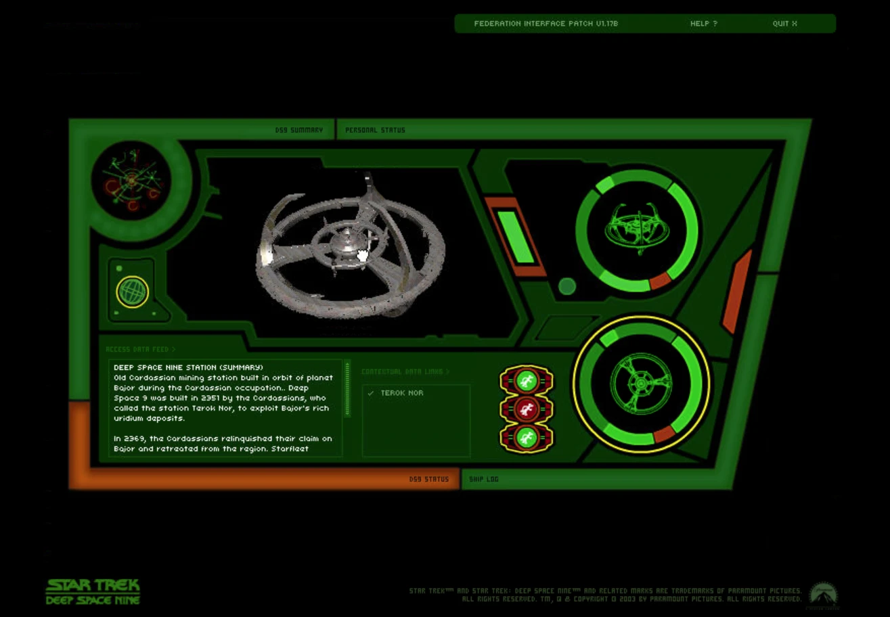
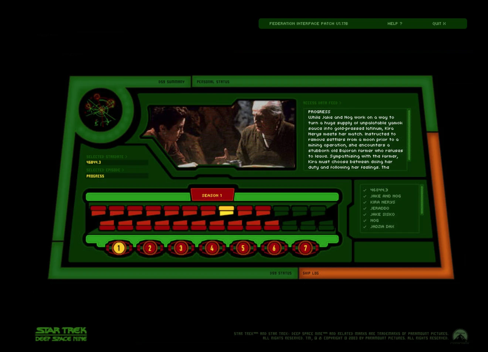
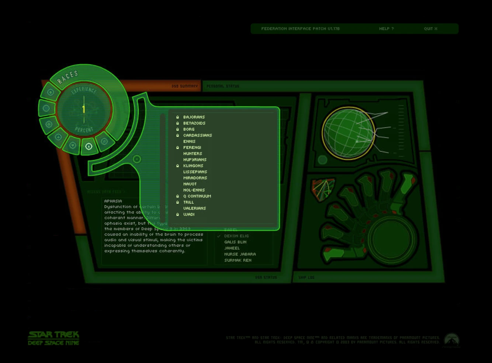

# DS9 Virtual Space Station in Docker

Run the *Star Trek: Deep Space Nine – Virtual Space Station* CD-ROMs from 2003 in your web browser on any machine with Docker. These are the bonus discs from the season DVD box sets, and they came out for Windows 98/XP.

The container uses Wine, a virtual display and noVNC to run the original program. It installs everything itself on the first start, and it fixes the problems that stop the program working today:
- the dead online registration site
- the CD label check
- a DirectX 7 crash under Wine
- the season and experience locks

> **You need your own discs.** This repo contains no Paramount content: no disc images, program files or encyclopedia data. You supply the ISO images (see [discs/README.md](discs/README.md)). This is an unofficial fan project, not affiliated with or endorsed by Paramount, CBS or the original developers. Star Trek and related marks are trademarks of their owners.

## Screenshots

| 3D station view | Episode menu | Options menu |
|---|---|---|
|  |  |  |

*Screenshots of the original 2003 program running in this container. Star Trek content © Paramount; shown for illustration only.*

## Quick start

1. Install [Docker](https://docs.docker.com/get-docker/), including Docker Compose.
2. Clone this repo:
   ```bash
   git clone https://github.com/SimonTheGeek/ds9-virtual-space-station-build-with-your-discs.git
   ```
   ```bash
   cd ds9-virtual-space-station-build-with-your-discs
   ```
3. Image your **Season 7** and **Season 1** CD-ROMs into `discs/` as `DS9_disc7.iso` and `DS9_disc1.iso`. On Linux you can use `scripts/image_disc.sh`. Full details are in [discs/README.md](discs/README.md).
4. Build and start it:
   ```bash
   docker compose up -d --build
   ```
5. Open **http://localhost:6080/vnc.html** and click *Connect*.

The first start takes a few minutes: it builds the image and installs the program. You can follow the setup with:

```bash
docker exec ds9-vss tail -f /root/.wine/ds9-setup.log
```

## Options (in `compose.yaml`)

| Setting | Default | Change it to… |
|---|---|---|
| `UNLOCK_ALL` | `"1"`: every encyclopedia item marked as visited (120% experience, Captain rank) | `"0"` to start fresh and unlock items by exploring |
| `ports` | `127.0.0.1:6080:6080`: this computer only | `"6080:6080"` to use it from other devices on your home network. **noVNC has no password, so never expose it to the internet.** |

To start again from scratch (this deletes your progress):

```bash
docker compose down -v && docker compose up -d
```

To back up or restore your progress, use `scripts/backup_volume.sh`.

## Rank and experience

**This is set to full:** every encyclopedia item is marked as visited, so you start with **120% experience** and nothing is locked. Your rank shows **Captain**, because all 7 seasons are installed.

The program shows the percentage as 120%, not 100%. That's how the original program counts it, so it isn't a fault.

To change it:
- **Before the first start:** set `UNLOCK_ALL: "0"` in `compose.yaml` to start at 0% experience and unlock items by exploring, as the original intended. Your rank stays Captain: rank appears to follow the number of seasons installed (all 7 here), not experience. This setting is only read during first-run setup. If you've already started the container, run `docker compose down -v && docker compose up -d` to start again. **That deletes any progress.**
- **Later, by hand:** your progress is kept in `C:\Program Files\DS9\Userdat.ini` inside the container. Under `[CurrentUser]`, the lines `disk1=[...]` to `disk7=[...]` list the visited item IDs for each season. Remove IDs to lower that season's percentage, or empty a list to reset that season.
  - Edit the file only while the program is closed, because it rewrites the file when it quits.
  - To edit it:
    ```bash
    docker exec ds9-vss supervisorctl stop ds9
    ```
    ```bash
    docker cp "ds9-vss:/root/.wine/drive_c/Program Files/DS9/Userdat.ini" .
    ```
    Edit `Userdat.ini` in any text editor, then copy it back:
    ```bash
    docker cp Userdat.ini "ds9-vss:/root/.wine/drive_c/Program Files/DS9/Userdat.ini"
    ```
    ```bash
    docker exec ds9-vss supervisorctl start ds9
    ```
- `docker/mkuserdat.py` is the script that writes the full list from your disc's encyclopedia database.

## What's on each disc

Each 2003 DS9 season box set (UK, Region 2) came with one CD-ROM. Each disc carries the program plus the encyclopedia up to that season, so later discs contain everything on the earlier ones.

| Disc | Label | Date | Encyclopedia | Images / 3D models | New on this disc | Needed? |
|---|---|---|---|---|---|---|
| 1 | `DS9` | 2003-02-06 | none | 1 / 1 | The program itself, the installer, the screensaver, the **DS9 station 3D model** and extra Xtras (plug-ins) | **Yes**: the station model is only on this disc |
| 2 | `DS9_2` | 2003-03-17 | Seasons 1–2 (371 entries) | 132 / 10 | The encyclopedia (6 languages), its images, updated program files | No: everything is on disc 7 |
| 3 | `DS9_3` | 2003-05-08 | Seasons 1–3 (528) | 207 / 10 | Season 3 entries and images; `bypass_firewallv1.exe` (an official patch that skips online registration) | No |
| 4 | `DS9_4` | 2003-06-26 | **Seasons 1–7 (1,105)** | 444 / 26 | Seasons 4–7 entries and images: the complete encyclopedia | No |
| 5 | `DS9_5` | 2003-06-26 | Seasons 1–7 (1,105) | 444 / 26 | **Nothing new**: only the installer differs | No |
| 6 | `DS9_6` | 2003-06-26 | Seasons 1–7 (1,105) | 444 / 26 | **Nothing new**: only the installer differs | No |
| 7 | `DS9_7` | 2003-06-26 | Seasons 1–7 (1,105) | 444 / 26 | Installer, plus an updated `init.dxr` (the final version of the program) | **Yes**: the newest program, and the label the program checks for |

**About "Bypass Firewall":** despite its name, `bypass_firewallv1.exe` (discs 3–7) doesn't touch any firewall. It's the publisher's official patch for the registration check: it writes a registration code so that the program skips online registration.

**In short:** the content stops growing at disc 4, and discs 5 and 6 add nothing. The container uses **disc 7** (the final program and full encyclopedia) as D: and **disc 1** (the station model) as E:. All seven are kept for completeness.

## What's in this repo

| Path | Purpose |
|---|---|
| `docker/Dockerfile` | Debian bookworm, Wine (32-bit), Mesa, Xvfb, fluxbox, x11vnc, noVNC, supervisord |
| `docker/start-ds9.sh` | First-run setup, then launches the program |
| `docker/reg/` | Registry settings: install keys, all seasons, Shockwave 3D renderer, Wine `ddraw` override |
| `docker/mkuserdat.py` | Writes the "everything visited" progress file from *your* disc's encyclopedia database |
| `scripts/` | `image_disc.sh` (Linux disc imaging), `backup_volume.sh` (back up or restore progress) |
| `docs/` | [Disc details](docs/DISCS.md) and [every problem and fix](docs/HOW-IT-WORKS.md) |

## Known limitations
- **No sound.** The container has no audio device. Contributions welcome.
- Tested only with the UK (Region 2) box-set discs. Discs from other regions may have different labels or files.
- The search menu on the top right of the side panels jumps back to *DS9 Summary*. The original program does this too.
- 3D runs on software OpenGL, so it's slow-ish on old CPUs.
- Built for x86-64. Apple Silicon or ARM hosts need emulation, which is untested.

## Licence
The scripts and configuration are under the [MIT licence](LICENSE). That licence doesn't cover the Virtual Space Station itself.
